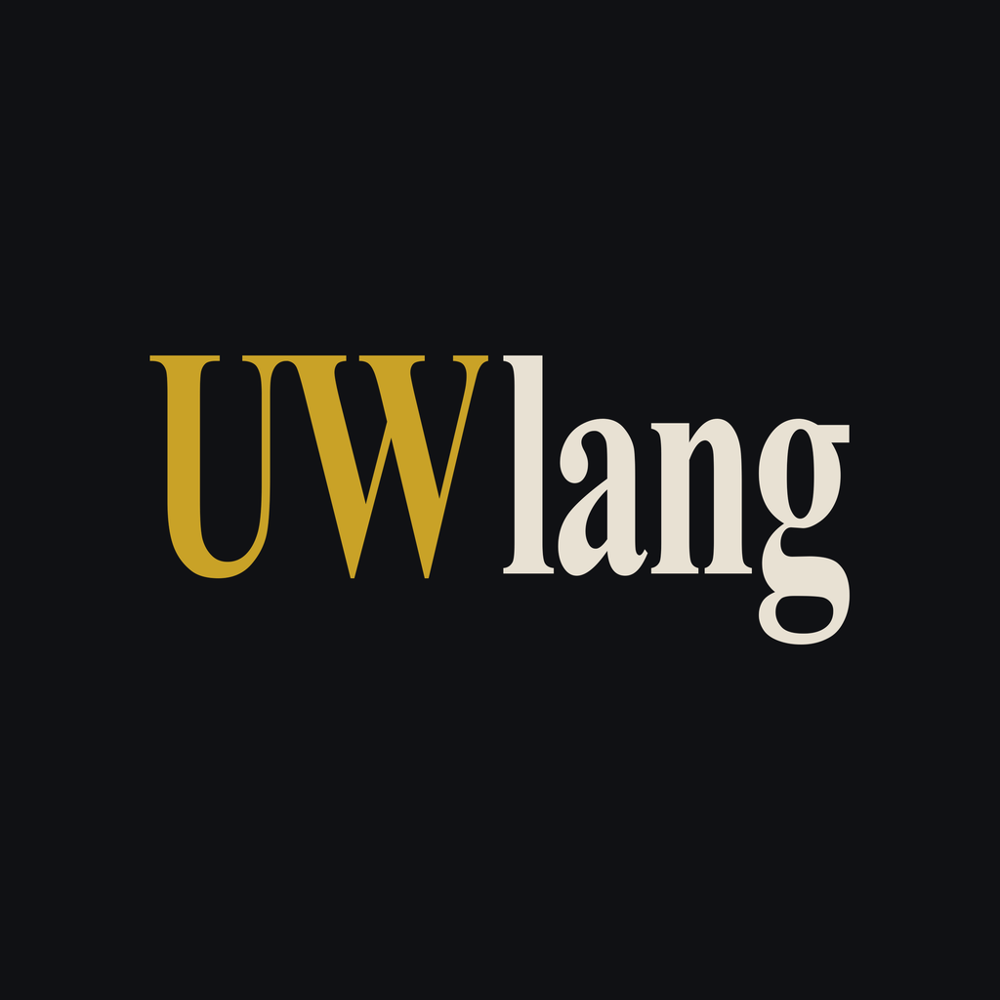

<p align="center">
  
</p>

<p align="center">
  <b>A programming language for <i>Mount & Blade: Warband</i> modding.</b><br>
  Write ordinary code. Get Module System 1.171.
</p>

<p align="center">
  <a href="https://discord.gg/cjKbchTa2c"></a>
  
  
</p>

---

The Module System is Warband's assembly: registers, slot numbers, fixed-point integers and `try_begin` trees.
UW is the language on top of it: `fn`, `if`, `for`, variables and events, compiled to the official Module System.

**You write**

```uw
player.agent.stamina += 15 per second
```

**UW generates** *(real `uw build` output)*

```python
try_begin,
(get_player_agent_no, ":_uw20"),
(agent_get_slot, ":_uw21", ":_uw20", 29),
(store_mul, ":_uw22", 15000, ":uw_frame_ms"),
(val_div, ":_uw22", 1000),
(val_add, ":_uw21", ":_uw22"),
(val_clamp, ":_uw21", 0, 100001),
(agent_set_slot, ":_uw20", 29, ":_uw21"),
try_end,
```

Slot allocation, fixed-point math, frame timing and range clamping are the compiler's job, not yours.

## Why UW

- **A language, not a feature pack.** Sprinting, stamina, stealth are not built in; they are a few lines of your own UW. See [`examples/alex`](examples/alex).
- **No ceiling.** Engine operations are exposed under readable names taken from the kit itself; 901 of 1,060 are reachable from the core language today.
- **Errors before the game starts.** Every name is checked against the kit, reported at `file:line`, with suggestions.
- **Save-safe.** Field slots are pinned in `slots.lock` and never reused.
- **Non-destructive.** Your Module System folder is never touched; every build runs in a fresh staging copy.

## Quick start

Requires Rust, Warband 1.174, and the official Module System 1.171 with Python 2.7 from TaleWorlds (never bundled here).

```sh
git clone https://github.com/RobloxPro1453/uw-lang.git && cd uw-lang
cargo build --release -p uw_cli
cargo run -q -p uw_cli -- build examples/alex --no-install
```

Place the Module System in a `Module_system*` folder at the repository root, or pass `--kit <dir>`.
Drop `--no-install` to install the mod into Warband's `Modules/` folder. `uw --help` lists every command.

## Learn more

| | |
|---|---|
| [Language guide](docs/guide.md) | A tour of the language |
| [Specification](docs/dil/CORE-v0.md) | The core language in detail |
| [Architecture](docs/ARCHITECTURE.md) | How the compiler works |
| [Development](docs/DEVELOPMENT.md) | Building, testing, contributing |
| [VS Code](editors/vscode) | Highlighting, diagnostics, completion |
| [Document map](docs/HARITA.md) | Every design, planning and progress document (Turkish) |

## Status

Early and experimental (0.1.0); syntax may change. Loops over engine collections and fixed-size arrays are in progress, and in-game testing so far covers only a few examples. Expect rough edges, and please [report them](https://discord.gg/cjKbchTa2c).

## Contributing

Issues and pull requests are welcome. Run `cargo test --workspace` before submitting.
One rule shapes the project: the compiler gains general language features only; gameplay mechanics belong in user code.

The project is developed with AI agents under the [claudevolution](AGENTS.md) workflow; its configuration, decisions, lessons and plans are kept in the repository (`AGENTS.md`, `.evrim/`, `docs/`), so a fresh clone carries the full working context. Internal working documents are in Turkish.

---

<sub>Dual-licensed under [MIT](LICENSE-MIT) or [Apache-2.0](LICENSE-APACHE). Unofficial; not affiliated with or endorsed by TaleWorlds Entertainment. Mount & Blade and Warband are trademarks of their respective owners. This repository contains no TaleWorlds assets or Module System source.</sub>
