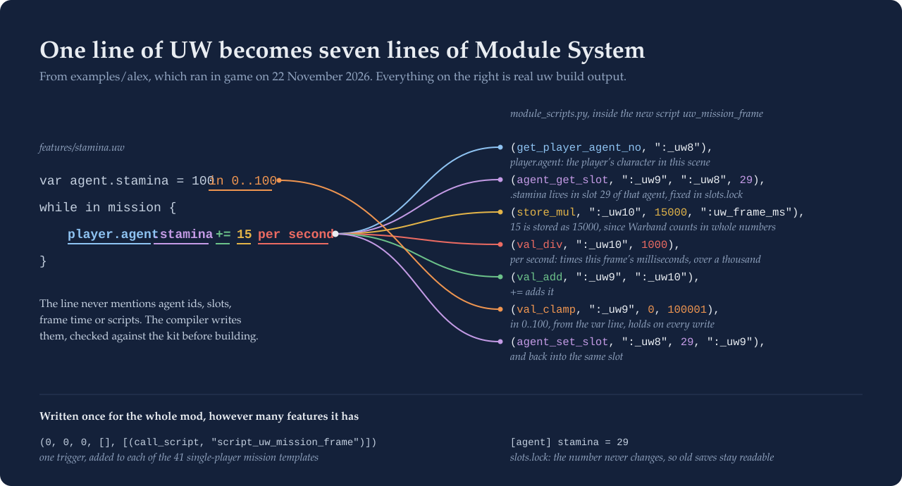

# UW (Universal Warband)

A general-purpose modding language and compiler for *Mount & Blade: Warband* 1.174, written in Rust. UW compiles to the official Module System 1.171, so you get the full power of the engine without writing Module System Python.

[](https://discord.gg/cjKbchTa2c)

> Unofficial and not affiliated with or endorsed by TaleWorlds Entertainment. Mount & Blade and Warband are trademarks of their respective owners.

<p align="center">
  
</p>

## Why

The Module System is the engine's assembly. Moving a number around means numbered registers (`reg0`, `s1`, `pos1`), hand-managed slot indices that break saved games if renumbered, fixed-point integers scaled by 1000, and `try_begin` / `neg|` / `this_or_next|` tuple trees.

UW plays the role Python plays relative to assembly. It is a plain programming language (`fn`, `if`, `for`, `while`, `var`, events, object fields) with access to the engine's operations. It does not ship ready-made mechanics: sprinting, stamina or stealth are not language features, they are ordinary programs written in UW (see [`examples/alex`](examples/alex)).

One line of UW:

```uw
player.agent.stamina += 15 per second
```

compiles (real output of `uw build examples/alex --no-install`, as written to the generated `module_scripts.py` overlay) to:

```python
try_begin,
(get_player_agent_no, ":_uw20"),
(agent_get_slot, ":_uw21", ":_uw20", 29),
(store_mul, ":_uw22", 15000, ":uw_frame_ms"),
(val_div, ":_uw22", 1000),
(val_add, ":_uw21", ":_uw22"),
(val_clamp, ":_uw21", 0, 100001),
(agent_set_slot, ":_uw20", 29, ":_uw21"),
try_end,
```

The slot number, the fixed-point scaling, the frame-time conversion and the clamp to the declared `0..100` range are handled by the compiler.

## Features

- Language constructs: `const`, `var` (global variables and per-object fields with value ranges), `let`, `fn`, `if` / `else`, `for`, `while ... otherwise`, `every`, `after`, `on <event>`, `ui.*` HUD parts.
- Literals with units: decimals, percentages (`150%`), colors (`#3FA34D`), durations (`2 seconds`, `3 days`) and rates (`15 per second`).
- Engine vocabulary generated from the kit rather than invented: every one of the 1,060 Module System operations has a readable dotted name (`troop.player.add_gold(50)`, `party.main_party.relocate_near_party(...)`), plus constants and records. Search it with `uw words`.
- Save-game safety: object fields get permanent slot numbers recorded in `slots.lock`; numbers are never reused.
- Scheduling: all time-based blocks of all features are merged into one campaign-clock trigger and one mission-frame trigger, and each build prints a static operation-cost report.
- Name and type checking against the kit before Python runs, with `file:line` diagnostics and "did you mean" suggestions.
- Safe builds: the Module System folder is never modified. Each build runs in a fresh staging copy, and installation only overwrites mod folders that UW itself installed.
- Inspection tools: `uw view`, `uw explain`, `uw browse`, `uw find`, `uw graph`, `uw rename`.
- VS Code extension in [`editors/vscode`](editors/vscode).

## Status

UW is early and experimental (version 0.1.0). Interfaces and syntax may still change.

What works, measured with the tools in this repository:

- `uw coverage --all` reports `core language: ... ops reachable 901/1060 (85.0%), lowered 515/515`: 901 of the 1,060 kit operations can be reached from core-language code.
- `examples/alex` (custom start, stamina bar, Alt-to-sprint) compiles with the kit and was played in Warband 1.174.
- A decompiler can render Native scripts, menus, presentations and other tables as UW text; `uw view` reports how much of Native's operation blocks the core language can currently write.

What does not work yet:

- About 160 operations are not reachable from the core language (position/vector math and text-building operations among them).
- Loops over engine collections (agents, parties), string interpolation and fixed-size arrays are in progress.
- Hooks are only partially covered, and not all 28 Module System tables can be defined from scratch in the core language yet.
- Most behavior has been verified by compile-time tests; in-game verification covers only a few examples. Expect bugs.

## Quick start

Prerequisites:

- The Rust toolchain (`cargo`).
- Mount & Blade: Warband 1.174.
- The official Module System 1.171 and Python 2.7, obtained separately from TaleWorlds. UW never bundles or redistributes them; it runs your local copy in a staging clone.

Build the tool:

```
git clone https://github.com/RobloxPro1453/uw-lang.git
cd uw-lang
cargo build --release -p uw_cli
```

Put the Module System kit in a `Module_system*` folder at the repository root (git-ignored) or pass `--kit <folder>`; Python 2.7 is expected at `C:\Python27\python.exe` unless `--python <path>` is given. Then compile an example without installing it:

```
cargo run -q -p uw_cli -- build examples/alex --no-install
```

Run `uw build examples/alex` (without `--no-install`) to install the mod into your Warband `Modules/` folder, then pick it in the launcher. Some commands (`explain`, `browse`, `roundtrip`) also need an atlas generated from your kit; see [docs/DEVELOPMENT.md](docs/DEVELOPMENT.md).

Main commands (see `uw --help` for all of them):

| Command | Purpose |
|---|---|
| `uw build [dir] [--no-install]` | Check, compile with the kit and install a mod |
| `uw check [dir] [--json]` | Check a project without building |
| `uw words` | List every name a `.uw` file may use |
| `uw explain <name>` | Describe a Native record and who uses it |
| `uw browse`, `uw find`, `uw graph` | Explore Native data and menu flow |
| `uw coverage`, `uw view` | Measure language coverage |
| `uw rename <record> "<new name>"` | Rename a record and the texts that mention it |
| `uw create <mod name>` | Export Native as an editable UW project |

## Documentation

- [docs/guide.md](docs/guide.md): language tour.
- [docs/dil/CORE-v0.md](docs/dil/CORE-v0.md): language specification.
- [docs/ARCHITECTURE.md](docs/ARCHITECTURE.md): compiler pipeline.
- [docs/DEVELOPMENT.md](docs/DEVELOPMENT.md): building and testing.
- [CHANGELOG.md](CHANGELOG.md).

## Project layout

| Path | Role |
|---|---|
| `crates/uw_core` | Core language: parser, lowering, kit binding, schedulers, HUD, `slots.lock`, `uw view` |
| `crates/uw_easy` | Generates the readable vocabulary for kit operations and constants |
| `crates/uw_atlas` | Index of the kit's records, operations and constants |
| `crates/uw_check` | Name, type and reference checker |
| `crates/uw_emit` | Emits Module System Python overlays |
| `crates/uw_kitrun` | Runs the kit in an isolated staging copy |
| `crates/uw_decomp` | Native-to-UW decompiler |
| `crates/uw_start` | Analysis of Native's start scripts |
| `crates/uw_diag` | Source spans and diagnostics |
| `crates/uw_syntax`, `crates/uw_lower` | Older record-oriented front end kept for compatibility |
| `crates/uw_cli` | The `uw` command-line tool |
| `kit-meta/` | Generated vocabulary and record schemas |
| `lib/` | Standard definitions written in UW |
| `py/` | Python helpers run inside the staging copy |
| `examples/` | Example mods |
| `editors/vscode` | VS Code extension |

## Examples

- [`examples/alex`](examples/alex): custom start in a town, a stamina resource with a HUD bar, and an Alt-to-sprint mechanic. Stamina and sprint are written entirely in UW.
- [`examples/steve`](examples/steve): the same features without the custom start.
- [`examples/praven_start`](examples/praven_start), [`examples/menu_demo`](examples/menu_demo): record-oriented examples (start flow, menu overrides).

## Editor support

[`editors/vscode`](editors/vscode) provides syntax highlighting, diagnostics (via `uw check --json`), completion and hover. See its README for installation.

## Contributing

Issues and pull requests are welcome. Run `cargo build --workspace` and `cargo test --workspace` before submitting; tests that need the kit or Python 2.7 skip themselves when those are missing. A guiding rule: the compiler gets general language mechanisms only; a specific gameplay mechanic belongs in user code under `features/`. See [docs/DEVELOPMENT.md](docs/DEVELOPMENT.md).

Questions, ideas and showcases are welcome on the [Discord server](https://discord.gg/cjKbchTa2c).

## License

Dual-licensed under [Apache-2.0](LICENSE-APACHE) or [MIT](LICENSE-MIT), at your option.

This repository contains no TaleWorlds game assets or Module System source files. `kit-meta/` holds generated names and metadata that describe the kit's interface.
