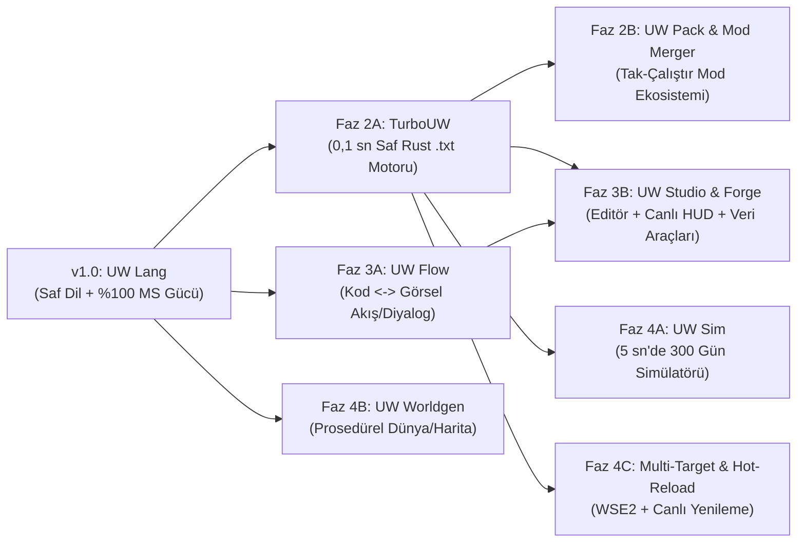

# Uzun Vadeli Ürün ve Ekosistem Yol Haritası (`v2.0+` — UW Suite Vizyonu)

> [!IMPORTANT]
> **ODAK KURALI (Sıfır Erken Dağılma):** Bu belge, **v1.0 Çekirdek Dil (`UW Lang`) tamamlandıktan sonraki** uzun vadeli stratejik kurgudur.
> - Aktif günlük iş sırası **her zaman** [docs/ROADMAP.md](../ROADMAP.md) ve [docs/dil/DIL_TAMAMLAMA_TEFTISI.md](../dil/DIL_TAMAMLAMA_TEFTISI.md) belgelerindedir.
> - v1.0 (dilin %100 güce ulaşması ve gerçek mod sınavlarını geçmesi) bitmeden aşağıdaki v2+ fazlarına erken dalınmaz. Bu belge, büyük resmi unutmamak ve v2+ kurgusunun sırasını, bağımlılıklarını ve önceliğini şimdiden netleştirmek için tutulur.
> - Teknik ayrıntılar uygulamaya geçilmeden önce kitte/oyunda doğrulanır ve kanıta göre esnekçe güncellenir.

---

## 1. Büyük Kurgu: Neden Bu Sıra? (4 Katmanlı Mimari)

Büyük araç ekosistemlerinin çoğu her şeyi aynı anda yapmaya kalktığı için yarım kalır. UW'nin üstünlüğü, her katmanın bir öncekinin üstüne **doğal çarpan** olarak oturmasıdır:

**Sıralamanın temel mantığı:**
1. Önce **hız ve bağımsızlık (`TurboUW`)** çözülür → çünkü 28 saniyelik Python 2.7 derlemesi aradan çıkmadan ne anlık mod birleştirici (`Mod Merger`) ne canlı editör (`UW Studio`) ne de hızlı test akıcı olur.
2. Sonra **topluluk çarpanı (`UW Pack + Mod Merger`)** açılır → çünkü Warband oyuncularına "Skyrim gibi 10 modu tek tıkla birleştirip oyna" gücünü vermek UW'yi küçük bir geliştirici aracından **on binlerce kişinin kurduğu platforma** dönüştürür.
3. Ardından **görsel üretim katmanı (`UW Suite`: `Flow` + `Studio` + `Forge`)** kurulur → artık arkada 0,1 sn'de derlenen ve paket birleştiren kaya gibi bir motor vardır; görsel araçların ürettiği her şey tertemiz `.uw` kodu olur.
4. En son **ileri AAA katmanı (`UW Sim`, `Worldgen`, `WSE2 / Hot-Reload`)** eklenir → büyük tam dönüşüm ekiplerinin yıllar süren emeğini haftalara indirir.

---

## 2. Öncelik ve Önem Matrisi (Özet Tablo)

| Faz | Kod Adı | Önem Derecesi | Topluluk Etkisi | Zorluk | Önkoşul |
|---|---|---|---|---|---|
| **2A** | **TurboUW** (`UW → Warband .txt`) | **Kritik (P0)** | Çok Yüksek (Python'suz, 0,1 sn derleme) | Yüksek | v1.0 UW Lang |
| **2B** | **UW Pack & Mod Merger** | **Kritik (P0)** | Devrimsel (Warband'da ilk kez çoklu mod birleştirme) | Orta-Yüksek | 2A (`TurboUW`) + `slots.lock` |
| **3A** | **UW Flow** (`graph_viewer` → Çift Yönlü Görsel Akış) | **Yüksek (P1)** | Çok Yüksek (kod bilmeyen tasarımcıyı içeri alır) | Orta | v1.0 `uw view` + `graph_viewer` |
| **3B** | **UW Studio & UW Forge** (IDE + Canlı HUD + Asker/Eşya/Harita) | **Yüksek (P1)** | Çok Yüksek (Morgh's + OpenBRF eziyetini bitirir) | Yüksek | 2A + 3A + LSP |
| **4A** | **UW Sim** (Ekransız 300 Gün Simülatörü) | **Stratejik (P2)** | AAA Kalite (geç oyun çökmelerini sıfırlar) | Yüksek | 2A + v1.0 IR |
| **4B** | **UW Worldgen** (Prosedürel Dünya/Harita) | **Stratejik (P2)** | Yüksek (sıfırdan tam dönüşüm engelini kaldırır) | Orta-Yüksek | v1.0 28 Tablo + `map.txt` |
| **4C** | **Multi-Target (WSE2) & Hot-Reload** | **İleri (P2)** | Yüksek (modern motor deneyimi) | Yüksek | 2A + 3B |

---

## 3. Faz Faz Stratejik Kurgu

### Faz 2A — **TurboUW**: Doğrudan `UW → Warband (.txt)` Motoru *(Önem: P0)*
- **Amaç:** `uw_emit + uw_kitrun` (Python 2.7, ~28 sn) yanına saf Rust ile doğrudan Warband `.txt` dosyalarını üreten ikinci bir arka-uç (`TurboUW`) eklemek. İki motor da korunur: isteyen resmî uyumluluk için `Classic`, isteyen hız ve sıfır kurulum için `TurboUW` seçer.
- **Neden ilk sırada?**
  - Kullanıcıdan Python 2.7 (ve uzun vadede ayrı Module System indirme) zorunluluğunu kaldırır; Native verisi doğrudan kullanıcının kendi `Modules/Native/*.txt` kurulumundan okunabilir (telif açısından %100 temiz).
  - Derleme süresini **~28 saniyeden ~0,1 saniyeye** indirir; sonraki bütün görsel ve birleştirici araçların yakıtıdır.
- **Kabul / Bitti Ölçüsü:** Aynı UW projesi hem `Classic` (Python 2.7) hem `TurboUW` (saf Rust) ile derlendiğinde üretilen **32 `.txt` dosyası bayt bayt birebir eşit** çıkar (sıfır sessiz bit hatası; `yardimciolabilir/_raporlar/derin/02-txt-format-ve-bitmask-sartnamesi.md` başlangıç referansıdır, her tablo kitle doğrulanır).
- **Bu fazın doğal yan ürünleri (düşük ek maliyet):**
  - `uw release`: Tek komutla sürümleme, temiz `.zip` ve Nexus/ModDB/Steam Workshop paketi.
  - `uw test --scene <sahne>`: Yeni oyun/karakter yaratma beklemeden doğrudan test sahnesinde başlatma.

---

### Faz 2B — **UW Pack & Mod Merger**: Tak-Çalıştır Mod Ekosistemi *(Önem: P0)*
- **Amaç:** Warband'ın 15 yıllık *"aynı anda yalnız tek mod oynanır"* sınırını kırmak. Modcular özelliklerini bağımsız UW paketleri olarak yayınlar (`stamina`, `diplomacy`, `freelancer`, `naval_battles`); hem modcular hem normal oyuncular istedikleri paketleri tek listede seçip çakışmasız tek Warband moduna derler.
- **Neden mümkün?** UW'nin `features/` yalıtımı, `slots.lock` çakışmasız slot kilidi, tek gizli kare/saat dağıtıcısı, tek paylaşımlı HUD sunumu ve `TurboUW`'nin 0,1 sn derleme hızı bu işin tam altyapısıdır.
- **Kapsam:**
  - Paket manifestosu (`uw.toml` bağımlılıkları, sürüm kilidi, ad alanı izolasyonu).
  - Çakışma dedektörü: İki paket aynı Native kaydını ezmeye çalışırsa net çözüm önerisi sunar.
  - Oyuncu arayüzü: Kod bilmeyen oyuncular için tikle → **"Birleştir & Oyna"** başlatıcısı.
- **Bu fazın doğal yan ürünleri:**
  - **Save-Game Guard:** Güncelleme öncesi *"Eski kayıtlı oyunlarla %100 uyumlu mu?"* otomatik raporu.
  - `uw import`: Var olan klasik Module System modlarını okunur UW projesine aktarma köprüsü.

---

### Faz 3A — **UW Flow**: Çift Yönlü Görsel Akış, Diyalog ve Görev Editörü *(Önem: P1)*
- **Amaç:** `docs/graph_viewer/` içinde temeli hazır olan Obsidian tarzı sonsuz tuval görüntüleyicisini salt-okunurluktan çıkarıp **çift yönlü (Kod ↔ Görsel) canlı editöre** dönüştürmek.
- **Çift yönlü tek gerçeklik:**
  - Kodda `menu` veya `dialog` değişince görsel tuvaldeki kart ve oklar anında güncellenir.
  - Görsel tuvalde yeni kart açıp ok bağlayınca ilgili `.uw` dosyasına insan eliyle yazılmış gibi temiz kod yazılır.
  - Native ile fark görünümü: silinen/ulaşılmaz kalan düğümler kırmızı, yeniler yeşil, değişenler turuncu.
- **Kabul / Bitti Ölçüsü:** Hiç kod yazmadan 5 ekranlık dallanan bir menü/diyalog akışı görsel tuvalden çizilip 0,1 sn'de derlenebilir ve üretilen `.uw` kodu elle düzenlendiğinde tuval bozulmadan geri okur.

---

### Faz 3B — **UW Studio & UW Forge**: Tek Çatı Masaüstü Stüdyosu *(Önem: P1)*
- **Amaç:** Kod editörü (LSP + otomatik tamamlama + hata alt-çizgisi) ile görsel veri editörlerini tek, hafif, şişkinliksiz masaüstü uygulamasında (`UW Suite`) toplamak.
- **Bileşenler:**
  - **UW Studio (Kod + Canlı Önizleme):** `ui.bar`, `screen` ve `menu` yazarken yan panelde kullanıcının kendi Warband dokularıyla canlı ekran önizlemesi.
  - **UW Forge (Veri Editörleri):** Görsel asker terfi ağacı, türe duyarlı akıllı eşya editörü (kılıç/zırh/at bit çakışmasını engeller), harita üstünde şehir/kale/köy yerleştirici.
  - **Blender Köprüsü (Sıfırdan 3B motor yazmak yerine):** 3B önizleyici + Blender'dan tek tıkla `.brf`/`.dds` paketleme ve UW kaydına bağlama (OpenBRF eziyetini ortadan kaldırır).
- **Bu fazın doğal yan ürünleri:**
  - `uw translate`: Tek tıkla çoklu dil çeviri tablosu ve eksik çeviri yüzdesi.
  - `uw balance`: Eşya/asker istatistiklerindeki aykırı değerleri (outlier) yakalayan denge tarayıcı.
  - `uw wiki`: Modun tüm asker ağaçlarını, eşyalarını ve krallıklarını otomatik HTML ansiklopediye basma.
  - `uw ai-context`: Projenin tüm adlarını + dil özetini dış LLM'ler için tek dosyada dışa aktarma.

---

### Faz 4A — **UW Sim**: Ekransız Hızlı Warband Simülatörü *(Önem: P2)*
- **Amaç:** Warband'ın grafik motorunu açmadan, yalnız UW/MS işlem mantığını ve dünya tablosunu Rust içinde koşturan **ekransız (headless) sanal makine**.
- **Modcuya kazandırdığı güç:**
  - *"Modumu 300 oyun günü hızlandırılmış simüle et"* → ~5 saniyede tüm `every` tetikleri, ekonomi/krallık döngüleri ve görev durumları gerçekten çalışır.
  - 200. günde patlayan enflasyon, sıfıra bölme, kilitlenen görev veya sonsuz döngü daha **oyun 1 kez bile açılmadan** yakalanır.
  - **UW Doctor & `uw diagnose <rgl_log.txt>`:** Hem derleme öncesi statik çökme denetimi hem oyun içi `rgl_log.txt` kayıtlarını doğrudan `.uw` dosya/satırına çevirme.

---

### Faz 4B — **UW Worldgen**: Prosedürel Dünya ve Harita Üretim Motoru *(Önem: P2)*
- **Amaç:** Sıfırdan tam dönüşüm (total conversion) yaparken 150 köy, 80 lord, 6 krallık ve `map.txt` hazırlama yorgunluğunu ortadan kaldırmak.
- **Çalışma biçimi:** Modcu yükseklik haritası / arazi fırçası boyar veya tohum (seed) + parametre (*"5 krallık, 25 şehir, 80 köy"*) verir → UW tutarlı `map.txt` + coğrafyaya uygun şehir/kale/köy yerleşimi + krallık/lord iskeletini **düzenlenebilir saf `.uw` dosyaları** olarak üretir.

---

### Faz 4C — **Multi-Target (WSE2) & Canlı Sıcak Yenileme (Hot-Reload)** *(Önem: P2)*
- **Multi-Target:** `uw.toml` içinde `target = "warband"` (düz 1.174) veya `target = "wse2"` (WSE2 ek işlemleri/Lua köprüsü) seçimi. Dilin kelimeleri zaten kitten veri olarak okunduğu için motor değişikliği derleyici çekirdeğini bozmaz.
- **Hot-Reload (`[İDDİA — WSE2/köprü imkânı deneyle doğrulanacak]`):** Editörde `Ctrl+S` yapıldığında oyunu kapatıp açmadan HUD, menü ve sabit değerlerin canlı güncellenmesi.

---

## 4. Kurumsal Denge İlkesi (Hangi Sıra Asla Bozulmaz?)

1. **Dil olmadan vitrin olmaz:** v1.0 (`UW Lang`) %100 bitmeden `UW Suite` arayüzüne dalınmaz.
2. **Görsel araç daima temiz `.uw` yazar:** Hiçbir görsel editör `.txt` dosyasını el altından yamamaz; tek kaynak gerçekliği her zaman insan tarafından okunabilen `.uw` metnidir.
3. **Sıfır TaleWorlds dosyası, sıfır kilitlenme:** Her araç (TurboUW, Suite, önizleyici) oyun varlıklarını yalnız kullanıcının kendi yasal Warband kurulumundan okur; depoya asla üçüncü taraf telifli dosya girmez.
